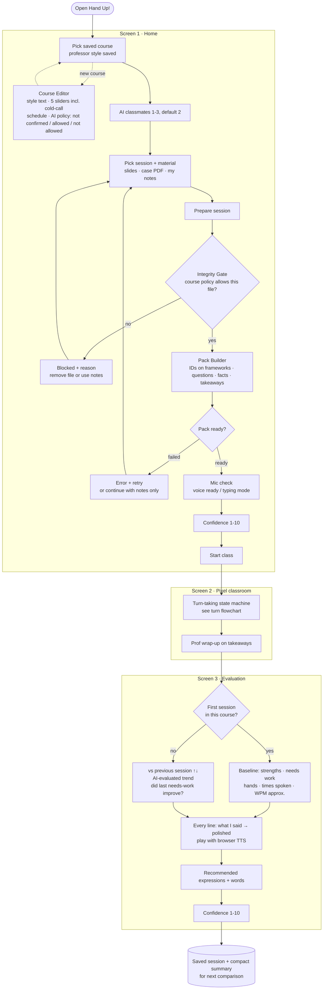
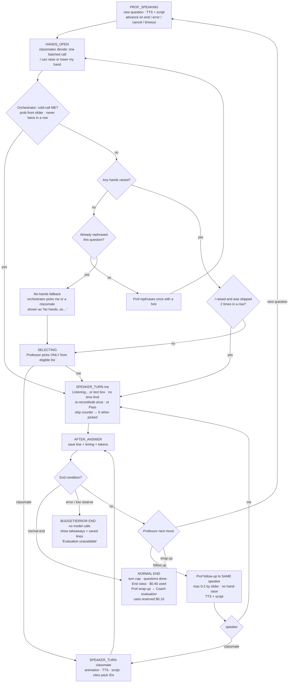
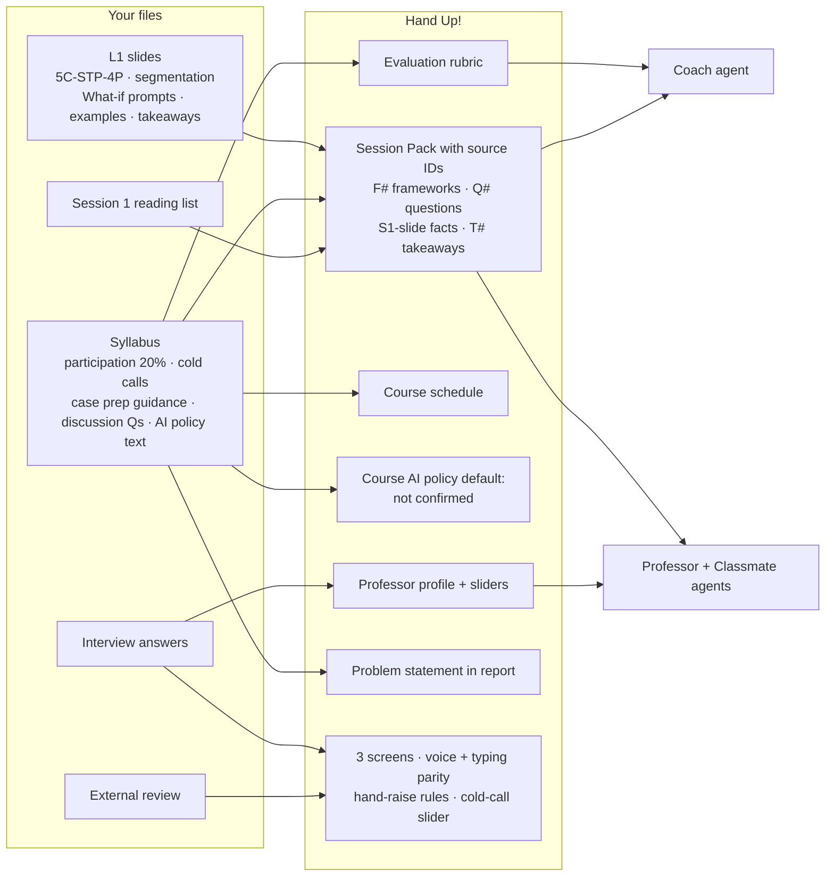

# Hand Up! — PRD v4.1 (built from MGT 411 Session 1 materials)

Author: Gawon Yi · 2026-10-26 · Status: approved for build
Service name: **Hand Up!** (final). Tagline: *"Raise your hand before the real class does."* Repo: `hand-up`.

Changes from v3: turn-taking authority and states defined (§6), voice constraints and full typing fallback (§7), first-session vs later evaluation (§5 Screen 3), three-state course AI policy (§5, §11), scope for today (§13), experiment design (§14), cost at 100 / 10,000 users (§10), source IDs on facts, flowcharts updated.
v4.1 (second review): bundled demo allowlist, budget reservation + two end types, cold call vs no-hands fallback, follow-up keeps the speaker, TTS timeout, skip-counter reset, grounding/caching/policy-note caveats.

---

## 0. Source data this PRD is built on

| # | File (from `consumer/course_files_export (1)/`) | What it contains | How Hand Up! uses it |
|---|---|---|---|
| D1 | `L1-Introduction_class.pdf` (44 slides, Prof. Jiwoong Shin) | Marketing as creating/capturing value; **5C → STP → 4P**; strategy as an **integrated set of choices**; superior value proposition (differentiation vs cost leadership); **segmentation** (descriptor "who", behavioral "what", benefit "why"; sizable, identifiable, actionable); examples: Gucci/Hermès/Southwest "What if…", Dove, AT&T, McDonald's, Uber surge (slide 41), NYT paywall (slide 42); Takeaways (slide 44) | **Framework layer** of the Session Pack. **Discussion questions** for the Session 1 demo. Takeaways = where the wrap-up should land. |
| D2 | `MGT 411 Customer- 2026 Syllabus 10.23.26.pdf` | Participation **20%** (attendance 10%, input 10%; "quality more important than quantity"; "cold-call should be expected"). **Case prep guidance**: read twice, root causes, case data for specific recommendations, pros and cons, no single right answer, explain theory and process, apply lecture frameworks. Schedule with **discussion questions per case**. AI policy text: "the case itself must never be uploaded, and you must not use AI to generate the substance of your assignment." | **Problem evidence.** **Evaluation rubric.** **Course schedule.** **Course AI policy** default (see §11). |
| D3 | `Session 1 Readings_FA26.pdf` (1 page) | Reading list: Dolan, "Framework for Marketing Strategy Formation" (HBP 8153) | Listed as the session reading; the note itself is not in the folder. |
| D4 | User interview (2026-10-26) | Decisions below | Product decisions |
| D5 | External review (2026-10-26) | Spec gaps: turn rules, voice limits, first-session evaluation, policy source, scope, experiment, scale costs | Incorporated in v4 |

Interview decisions (D4):
- **Home screen:** pick a saved course (professor style saved) + number of AI classmates + discussion material.
- **Classroom:** cozy, professional isometric pixel classroom on a light-sky app; the speaker gets a **yellow outline**; lines appear in an **RPG-style dialogue box** under the scene (no speech bubbles, no talking animation).
- **Turn rule:** nobody speaks unless they **raise a hand and the professor calls on them** (AI classmates included). The professor can **cold-call me** at a **frequency the user sets**.
- **Voice for everything**, with a **script** (subtitles) for every line. Browser built-in speech, **typing as a backup**.
- **Evaluation:** improvement vs my previous session in this course, what needs work, **every line I said polished**, **recommended expressions and words**. One-tap confidence before/after.
- Purpose: rehearse a case-based discussion before class, then speak well in the real one. Generating graded write-ups is out of scope.

---

## 1. One-liner
Hand Up! is a voice-first mock class: pick your course, and an AI professor (styled like your real one) and AI classmates run a discussion on the session's material in a pixel-art classroom. You raise your hand to speak, sometimes get cold-called, and afterwards see how to say it better.

## 2. Problem (evidence from D2)
- In MGT 411, **20%** of the grade is participation; half is **input judged on quality and quantity**; cold calls are expected.
- The syllabus asks for root cause → evidence from the case → specific recommendation → pros and cons → theory. Hard on the spot; harder in a second language.
- Students can prepare alone, but cannot practice **the live, spoken part**: getting the floor, being cold-called, answering follow-ups out loud, in natural classroom English.

## 3. Users
- Primary: non-native English MBA students in case-method core courses (the author is user #1).
- Secondary: anyone who freezes when speaking up in class.

## 4. Success metrics (in the app)
| Metric | How |
|---|---|
| Speaking quality | Rubric scores (from D2), reported as an **AI-evaluated performance trend** (questions differ between sessions, so a higher score is not proof of skill gain) |
| Participation quantity | Hands raised, times spoken, total speaking time |
| Fluency (approx.) | Words per minute from speech start/end events; labeled approximate |
| Confidence | One-tap 1–10 before and after each session |
| Cost | Real tokens and $ per session; voice uses no model tokens |
| Safety | Integrity, injection and cap tests pass |

Non-goals (v1): writing case write-ups, multi-user rooms, Canvas integration, pronunciation scoring.

---

## 5. Screens and features

### Screen 1 — Home
- **Course picker**: saved course cards (e.g., "MGT 411 Customer · Prof. Shin"). "+ Add course" → Course Editor.
- **Classmates**: 1–3 AI classmates (default 2) from Consultant, Skeptic, Practitioner, Quant.
- **Discussion material**: pick a session (questions auto-filled from the schedule), attach slides PDF, case PDF (if the course policy allows), my notes.
- **Prepare session** → Integrity Gate → Pack Builder runs **here**, with a progress state. On failure: clear error, retry, or continue with notes only. **Start class is enabled only when the Pack is ready.**
- **Mic check**: "Voice ready" or "Typing mode" (user can also choose typing).
- Confidence tap (1–10) → **Start class**.

**Course Editor**
- Course name, schedule (session → title → discussion questions).
- Professor: name, **free-text style description**, optional signature moves, sliders 1–5: **cold-call frequency**, follow-up pressure, framework emphasis, evidence demand, warmth.
- **Course AI policy** (3 states, see §11): Not confirmed (default) / Allowed (source note required) / Not allowed.

### Screen 2 — Classroom
- Isometric pixel classroom from stored image assets (our real classroom redrawn + character sheet; see DESIGN.md): professor at the front, empty board, classmates and me at desks; **yellow outline on the speaker**; raised-hand frame.
- Turn-taking follows §6. Voice follows §7.
- **RPG dialogue box** under the scene: portrait + name + current line, typed out with the voice (click to show all). On my turn it switches to my style and shows live speech-to-text (or a text input).
- **History drawer** (collapsible): full transcript with speaker names.
- Controls: **Raise hand** (button or space bar), **Pass** (when it is my turn), **End class**.
- Side panel (collapsible): Agent trace, Tokens & cost.

### Screen 3 — Evaluation
| First session in a course | Second session and later |
|---|---|
| Strengths and improvements of this session's answers | Rubric change vs the **previous session** (↑↓), labeled "AI-evaluated trend" |
| Hands raised, times spoken, speaking time, WPM (approx.) | Change in those numbers |
| Polished version of every line | Whether last session's "needs work" points improved |
| Confidence before → after | Confidence trend across sessions |

Always shown:
- **What needs work**: 2–3 points, each with a concrete fix.
- **Polished lines**: every line I said, *what I said* → *polished* (same idea, clearer structure, classroom-natural English, no new facts beyond the pack); play button reads it with browser TTS.
- **Recommended expressions and words**: 5–8 items tied to what I tried to say.
- Rubric (from D2), 1–5 with one-line reason: answered the question; used course frameworks; evidence from the material; specific recommendation with pros and cons; clear, concise, built on others.
- The Coach is told transcripts may contain speech-recognition errors and does not penalize obvious ones.

---

## 6. Turn-taking rules (the core loop)

**Authority split**
| Who | Decides |
|---|---|
| **Orchestrator** (code) | Who is eligible to speak; hand-raise state; cold-call trigger (random, probability from slider); starvation rule; turn and $ caps; which API call happens next; end conditions |
| **Professor** (LLM) | Which eligible candidate to call on; the question or follow-up text; whether to follow up, move to the next question, or wrap up |
| **Classmates** (LLM) | Whether to raise a hand (one batched call per turn); what to say when called on |

**States:** `PROF_SPEAKING → HANDS_OPEN → SELECTING → SPEAKER_TURN (classmate | me) → AFTER_ANSWER → (FOLLOW_UP → SPEAKER_TURN same speaker | PROF_SPEAKING | NORMAL_END | BUDGET_ERROR_END)`
- Nothing advances while audio is playing: the next step starts on the TTS end, error or cancel event, or a safety timeout (see §7); immediately in typing mode.

**Rules**
1. Professor asks a question (or follow-up).
2. `HANDS_OPEN`: classmates' hand decisions (batched); I may raise my hand any time during this window.
3. **Cold call check** (orchestrator, applies to **me only**): with probability = slider level × base rate (e.g., level 3 ≈ 25% per question), I get the floor without a raised hand. Never twice in a row.
4. **Eligible list** = raised hands (+ me if cold-called). **Starvation rule:** if I raised my hand and was not picked twice in a row, I am the only eligible candidate next time. The skip counter resets to 0 when I am picked or lower my hand; it does **not** reset when the question changes.
5. **No hands raised:** professor rephrases the question once with a hint; if still no hands, the **no-hands fallback** (separate from the cold-call slider) lets the orchestrator pick me or a classmate; the UI shows "No hands, so…".
6. Professor picks one candidate from the eligible list (cannot pick anyone else).
7. **My turn:** no time limit; mic or text box; I can re-record/edit once, or **Pass** (counts as a turn; professor moves on).
8. **Follow-up keeps the floor:** a follow-up goes to the same speaker directly; hand-raising and selection are skipped. Max 0–2 follow-ups in a row (follow-up pressure slider).
9. **End conditions → two end types:**
   - **Normal end** (turn cap 14, all questions covered, **End class**, or discussion budget $0.40 reached): professor wrap-up on the takeaways → Coach evaluation, paid from the **reserved $0.10**.
   - **Budget/Error end** (model error, or the reserve cannot cover the worst-case cost): **no model calls**; show the pack takeaways and the saved lines; Evaluation shows "Evaluation unavailable".
   - The hard cap of $0.50 per session is never exceeded: before every call the orchestrator checks the **worst-case cost** (counted input tokens + max output tokens × price).

---

## 7. Voice (browser) and fallback
- **Speech-to-text:** Web Speech API `SpeechRecognition` (Chrome/Edge; partial in Safari; not in Firefox).
- **Text-to-speech:** `speechSynthesis`, one voice/pitch/rate per character; the next step waits for the utterance **end, error or cancel** event, with a **safety timeout** (estimated duration from word count + 3 s), so voices never overlap and the class never freezes.
- **Privacy statement (accurate):** Hand Up! does not record, store, or send audio to its own server; it keeps only the text. **The browser's speech service (e.g., Google in Chrome) may process audio.** The mic is on only during my turn, with a visible "Listening…" indicator.
- **WPM:** words in my final transcript ÷ time between speech-start and speech-end events; shown as approximate (start delay and silences distort it).
- **Typing mode has full parity:** the whole class and the evaluation work without a microphone. If speech recognition errors or is unavailable, the app switches to typing automatically and shows why. AI lines still display as script if TTS fails.
- Build order: the full loop works in typing mode first; voice is a layer on top.

---

## 8. Worked example: Session 1 demo (from D1)
Session Pack (excerpt):
- frameworks: `F1` 5C; `F2` STP; `F3` 4P; `F4` "strategy is an integrated set of choices"; `F5` differentiation vs cost leadership; `F6` segmentation types and criteria
- questions: `Q1` "What if Gucci sold sweaters for $19.99? What breaks?" `Q2` "Why can demographic segmentation alone mislead?" `Q3` "Uber surge pricing and the NYT paywall: what kind of segmentation is this, and why does it work?"
- facts: `S1-42a` "77% of US newspapers had paywalls in 2018 (Lewis 2018)" [L1 slide 42]; `S1-41a` "Uber: higher willingness to pay at peak hours" [L1 slide 41]
- takeaways: `T1` start from customer needs; `T2` strategy = integrated choices; `T3` segment to customize offers and messages

Flow:
1. Prof: "What if Gucci sold sweaters for $19.99? What breaks?" (voice + script)
2. Skeptic and Consultant raise hands; I raise mine. Prof calls on the Skeptic.
3. Skeptic: "The price contradicts the positioning; the 4Ps stop being consistent." [F3, F4]
4. Prof calls on me. I speak; transcript appears.
5. Follow-up to me: "Which customer segment does Gucci lose?"
6. Q2; no hands → prof rephrases with a hint → still none → cold call to me.
7. Wrap-up on T1–T3 → Evaluation (first session: baseline view).

---

## 9. Agents and tools
| Agent | Job | Output (Pydantic) |
|---|---|---|
| **Integrity Gate** (code) | Apply the course AI policy before any upload text leaves the machine; refuse "write my write-up" requests | `GateResult{allowed, reason}` |
| **Pack Builder** | Material → Session Pack with source IDs | `SessionPack{frameworks[{id,text,source}], questions[{id,text}], facts[{id,text,source}], takeaways[{id,text}], decision?}` |
| **Professor** | Pick from eligible list; ask / follow up / next question / rephrase / wrap up | `ProfMove{action, target_id, text, question_id}` |
| **Classmates ×1–3** | Hand decisions (one batched call); remark when called, citing pack IDs | `HandDecisions{[{id, raise, reason}]}` / `Remark{text, builds_on, cited_ids[]}` |
| **Coach** | Evaluation content (§5 Screen 3), reads this session + previous session summary | `Evaluation{scores[], vs_previous?, improved[], needs_work[], polished_lines[], expressions[]}` |
| **Orchestrator** (code) | §6 state machine, caps, logging | — |

Browser (no model tokens): `SpeechRecognition`, `speechSynthesis`, speech timing.
Model: **gpt-6-luna** via Portkey (`PORTKEY_API_KEY`).

## 10. Tokenomics
- Voice: 0 model tokens.
- Identical prefix (system prompt + Session Pack) first in every professor/classmate call to make caching possible. An identical prefix does not guarantee a cache hit; the report uses **measured** `cached_input_tokens` only.
- One batched hand-decision call per turn.
- Recent turns only (sessions are short); running summary deferred.
- Output caps: professor ≤ 60 words, classmate ≤ 80 words.
- Coach reads only a compact summary of the previous session.
- Toggles to switch each cost cut on/off; compare cost and evaluation quality.
- Budget: per-session hard cap $0.50 = $0.40 discussion + $0.10 reserved for wrap-up and evaluation; worst-case pre-check before every call (§6 rule 9).
- In-app panel and report table, all from **measured** `logs/runs.jsonl`:

| Scale | Assumption | Shows |
|---|---|---|
| 1 run | one 14-turn session | input / cached / output tokens, $ |
| 1 user / month | 3 sessions/week × 4.3 weeks | $ |
| 100 users / month | same usage | $ |
| 10,000 users / month | same usage | $ (+ note on caching share and rate limits) |

## 11. Safety and integrity
| Risk | Defense | Evidence |
|---|---|---|
| Course AI policy (uploading = sending text to Portkey) | 3-state policy per course. **Not confirmed (default): case PDFs blocked.** Allowed: requires a source note (e.g., "instructor, class 10/26; TA email"); the note is the **user's statement, not verified official approval**. Not allowed: blocked. Gate (plain code) runs before any text leaves the machine. The bundled **fictional demo case** passes only via a **SHA-256 allowlist** of files shipped in the repo (`is_bundled_demo`); user uploads never get this exception; the bypass is logged and stated in the README. | Tests: real-looking case blocked under not_confirmed; bundled demo allowed; modified demo file blocked |
| Producing graded work | Coach refuses write-up requests; outputs are feedback on spoken practice | Test + screenshot |
| Copyright | Uploaded files local and git-ignored; fictional sample in repo | `.gitignore`, README |
| Prompt injection (materials or what I say) | Delimited data; agents never follow instructions inside it | Test |
| Made-up facts | Remarks and Coach cite pack IDs; unknown IDs rejected and regenerated once. v1 checks that cited IDs **exist**; checking that the source actually supports the sentence is limited (documented as a limitation) | Test |
| Speech errors | Re-record/edit; Coach ignores obvious recognition errors | Screenshot |
| Mic privacy | Accurate statement in §7; mic only during my turn | README |
| Runaway loops / overspend | State machine, turn cap, 2 retries, output caps, worst-case pre-check, $0.40 discussion budget + $0.10 reserve, hard cap $0.50, Budget/Error end with no model calls, visible message | Tests + screenshot |

## 12. UI and look
Cozy + professional (see DESIGN.md): light-sky page, cream panels, Inter for text, Pixelify Sans for logo/name tags; pixel art only in the scene. Scene from stored images (room.png redrawn from our real classroom, characters.png; code-drawn fallback). Yellow outline = speaking; RPG dialogue box; collapsible history. 3 screens + Course Editor. A first-time user finishes a session with no instructions.

## 13. Scope for today (deadline 6:00 PM ET)
| Feature | Decision |
|---|---|
| Professor + classmate discussion, hand-raise + cold call (§6) | Must |
| Voice + script + typing fallback (§7) | Must |
| Session Pack with source IDs + grounding | Must |
| Evaluation with polished lines + expressions | Must |
| Pixel-art classroom | Must |
| Token/cost logging + safety tests | Must |
| Comparison with previous sessions | **Previous session only** |
| Play button on polished lines | Browser TTS only |
| Classmates | **Max 3, default 2** |
| Running summary | Later |

## 14. Validation experiment (for the Impact section)
Same Session 1 topic (Q1–Q3), one real user (the author):
- **A — ChatGPT prep:** 15 minutes of prep with ChatGPT, then answer Q1–Q3 out loud (transcribed).
- **B — Hand Up!:** one Hand Up! session, then answer Q1–Q3 out loud.
- Compare with the same rubric (scored by the Coach and by self-review): rubric scores, prep time, confidence (1–10).
- Report honestly as n = 1, AI-evaluated, with transcripts in the appendix.

## 15. Technical constraints (graded)
FastAPI + one static HTML/JS page; `python app.py` → `http://localhost:8000` (localhost allows mic access). `.env` read from repo folder, then one folder up. `.env.example`, pinned `requirements.txt`, README (fresh clone under 10 minutes; "Chrome for voice; other browsers use typing mode"), "Try the demo" button, pytest tests.

## 16. Grading map
| Rubric item | Pts | Covered by |
|---|---|---|
| Novelty + value | 21 | Voice-first multi-agent class with real hand-raise dynamics, tuned to *your* professor |
| It works | 15 | §5–7 |
| Staff can run it | 5 | §15 + typing parity |
| Look + feel | 10 | §12 |
| Motivation + new | 8 | §2 + named competitors (Second Nature, HBS AI simulations, ChatGPT voice mode) |
| Agent design | 10 | §6, §9 + trace panel + §8 example |
| Tokenomics | 8 | §10 incl. 100 / 10,000 users |
| Safety | 8 | §11 |
| Impact | 5 | §4, §14 |
| Report + slides | 12 | after build |

## 17. Open items for the user
- Prof. Shin style description (free text) and slider values.

## 18. Flowcharts
`flowchart_user.png` (user flow), `flowchart_turn.png` (turn-taking state machine), `flowchart_data.png` (files → features).

